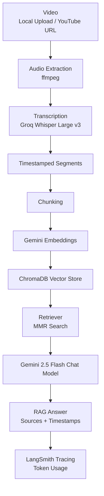

# Video-Intel-AI

An AI-powered video intelligence platform that converts local videos and YouTube videos into searchable knowledge using transcription, semantic search, Retrieval-Augmented Generation (RAG), and Gemini-powered question answering with LangSmith tracing.

## Streamlit - link

https://video-intel-ai-a4c5djydemgntx8kfezs2d.streamlit.app/
##

## Demo Video

https://github.com/user-attachments/assets/515e9443-d3f6-4d14-99b4-6e63cc2b28e0

## Project Features

- Upload and process local video files
- Process YouTube videos from URLs
- Extract audio from videos
- Transcribe speech with Groq Whisper
- Generate timestamped transcript segments
- Split transcript content into searchable chunks
- Create Gemini embeddings
- Store vectors in ChromaDB
- Retrieve relevant context using MMR search
- Ask questions across one or multiple videos
- Get source-aware answers with video names and timestamps
- Track LLM calls and token usage with LangSmith
- Streamlit interface for upload, processing, transcript preview, and chat

## Tech Stack Used

- Python
- Streamlit
- LangChain
- LangSmith
- Gemini 2.5 Flash
- Gemini Embeddings
- ChromaDB
- Groq Whisper
- yt-dlp
- ffmpeg

## Project Workflow

##

Author

**Vipul Singh**

linkedin: https://www.linkedin.com/in/vipul-singh2026/
